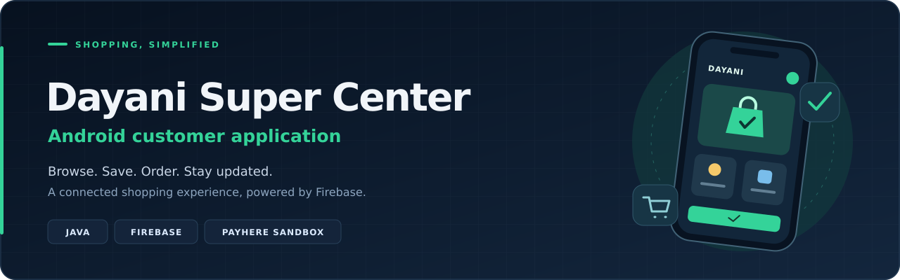

<div align="center">



### Everyday shopping, from your phone


</div>

---

## 📖 Overview

**Dayani Super Center** is a native Android shopping application that connects customers with the store. Customers can create an account, browse products, save favourites, manage their cart, select a delivery address and complete a sandbox checkout.

The companion **Dayani Super Center Admin** dashboard manages the catalogue, customer orders, notifications and support conversations. Both projects use the same Firebase backend.

## ✨ Features

| Feature | What customers can do |
| --- | --- |
| Account access | Register, verify an email address, log in and reset a password |
| Social sign-in | Use Google or Facebook after configuring the providers |
| Product catalogue | Browse categories, popular items, product images and descriptions |
| Search and filters | Search products and filter by category, price or rating; sort results |
| Cart and wishlist | Save favourites, manage quantities and review the cart |
| Delivery addresses | Save addresses and choose a location with Google Maps |
| Checkout | Select an address, review shipping and confirm with a checkout PIN |
| Payments | Open the PayHere sandbox payment flow in LKR |
| Order history | View purchases and follow pending, processing, shipped and delivered stages |
| Notifications | Read store messages and order updates inside the app |
| Customer support | Send messages to the administrator through the support chat |
| Profile settings | Update personal details, profile photo and security preferences |
| Local persistence | Use SQLite catalogue snapshots and SharedPreferences for local state |

## 🛠️ Technology Stack

<div align="center">


</div>

| Area | Technologies |
| --- | --- |
| Application | Java, Android SDK, XML layouts, View Binding |
| Interface | Material Components, Lottie, Glide |
| Authentication | Firebase Authentication, Google Credential Manager, Facebook Login |
| Cloud data | Cloud Firestore, Firebase Storage |
| Maps | Google Maps SDK, Google Play services Location |
| Payments | PayHere Android SDK 3.0.18; sandbox enabled |
| Local data | SQLite, SharedPreferences, Gson |
| Build | Android Gradle Plugin 9.0.1, Gradle Wrapper 9.2.1 |

## 🚀 Getting Started

### Requirements

- Android Studio compatible with Android Gradle Plugin **9.0.1**.
- JDK **17** or a compatible bundled Gradle JDK.
- Android SDK matching the configured compile SDK: **36, minor API level 1**.
- An Android **9 / API 28** or newer device or emulator.
- Your own Firebase project and configuration for any services you want to use.

The app targets API **36**. Its Java source and target compatibility are **Java 11**; the Gradle runtime uses the JDK listed above.

### 1. Open the project

Download or clone this repository. In Android Studio, choose **Open** and select the repository root containing `settings.gradle`, `gradlew` and the `app` folder.

### 2. Restore local configuration

The repository ignores the files below. If you already have a working local project, keep your existing copies.

| Local file | How to configure it |
| --- | --- |
| `app/google-services.json` | Download it from the Android app registered in your Firebase project |
| `app/src/main/res/values/strings.xml` | Copy `config-examples/strings.xml` here, then fill in your Maps and Facebook values |
| `app/src/main/java/com/nexcentauri/dayanisupercenter/util/PayHereConfig.java` | Copy `config-examples/PayHereConfig.java` here and enter your sandbox merchant ID |
| `local.properties` | Android Studio creates the machine-specific SDK path |

Register the Firebase Android application with package name **`com.nexcentauri.dayanisupercenter`**. Register the signing fingerprints required by Google sign-in, enable Email/Password and the social providers you plan to use, and configure Firestore and Storage access rules.

For Maps, enable the Maps SDK for Android and configure a key restricted to your Android package and signing certificate. For Facebook, configure your app ID, client token, login scheme and signing key hashes. When using a different Facebook app ID, also update the matching provider authority in `AndroidManifest.xml`.

The Firebase settings must point to the **same Firebase project** as the admin dashboard. Credentials for server-side operations and payment verification belong on a trusted server.

### 3. Sync and run

1. Complete **Gradle Sync** and install any SDK components Android Studio requests.
2. Select a device or emulator with Google Play services for Maps and Google sign-in.
3. Click **Run app**.
4. Create a customer account and add catalogue data through the companion admin dashboard.

Optional Windows terminal commands from the repository root:

```powershell
.\gradlew.bat testDebugUnitTest
.\gradlew.bat assembleDebug
```

On macOS or Linux, use `./gradlew` instead. Restore the local configuration before running these commands.

## 🔗 Shared Backend

| Firebase path | Purpose |
| --- | --- |
| `products` | Product information, images, prices and stock |
| `categories` | Catalogue categories |
| `users/{uid}` | Customer profile |
| `users/{uid}/addresses` | Saved delivery addresses |
| `users/{uid}/orders` | Customer orders and status history |
| `users/{uid}/cart` / `users/{uid}/wishlist` | Customer shopping data |
| `users/{uid}/notifications` | Store messages and order updates |
| `support_chats/{uid}/messages` | Customer and administrator messages |

Configure Firebase security rules for these paths before using your own backend. Deployment rules and a payment-verification server are not included in this project.

## 📁 Project Structure

| Path | Purpose |
| --- | --- |
| `app/src/main/java/.../activity/` | Authentication, shopping, checkout, profile and support screens |
| `app/src/main/java/.../fragment/` | Home, cart, orders and profile tabs |
| `app/src/main/java/.../adapter/` | Product, category, cart, order and chat lists |
| `app/src/main/java/.../model/` | Application data models |
| `app/src/main/java/.../util/` | Firebase helpers, local storage, images, maps and payments |
| `app/src/main/java/.../checkout/` | Checkout state, shipping calculations and local notifications |
| `app/src/main/res/` | XML layouts, drawables, animations and resources |
| `app/src/test/` | Existing unit tests |
| `config-examples/` | Templates for ignored local configuration |
| `docs/readme-banner.svg` | Repository banner |

## 🔧 Troubleshooting

| Issue | Check |
| --- | --- |
| `google-services.json` is missing | Add your Firebase Android configuration under `app/` |
| Missing string resources or `PayHereConfig` | Restore the ignored files using `config-examples/` |
| Gradle Sync fails | Check the Gradle JDK, SDK components and dependency downloads |
| Google sign-in fails | Check the package name, Firebase signing fingerprints and Google provider |
| Map stays blank | Check Maps SDK activation, API key restrictions and device services |
| Product list is empty | Add products and categories through the admin dashboard; check Firestore rules |
| Image upload fails | Check the configured Storage bucket, access rules and service availability |
| Sandbox payment fails | Check the PayHere merchant ID and registered Android package |

## 🔍 Project Scope

PayHere is configured for **sandbox testing**. A trusted payment-notification handler is required before accepting live payments. Order tracking displays fulfilment stages; it does not provide live courier GPS tracking. Notifications use the project's Firestore data and local Android notification support; a Firebase Cloud Messaging service is not included.

This README describes the supplied source. Build and device verification should be completed with your own configured services.

## 🤝 Contributing

Issues and pull requests are welcome. Describe the change, include relevant verification and keep local configuration out of commits.

---

<div align="center">

**Dayani Super Center** · Android Customer Application  
Companion repository: **`DayaniSuperCenter-Admin`**

</div>
